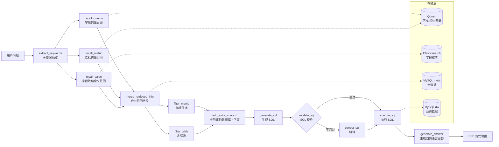

# Data Agent

基于 **LangGraph + LangChain** 的自然语言数据分析智能体（NL2SQL）。用户用自然语言提问，系统通过「关键词抽取 → 元数据召回 → 表/指标筛选 → SQL 生成 → SQL 校验/纠错 → SQL 执行 → 自然语言总结」的完整工作流，把问题转换成 SQL 并在数据仓库中执行，最后以流式（SSE）方式返回分析结果。

## 功能特性

- **关键词抽取**：基于 jieba 词性标注抽取问题中的关键词，并补充原句避免语义丢失
- **字段向量召回**：将字段名、描述、别名向量化写入 Qdrant，按语义相似度召回相关字段
- **指标向量召回**：将指标名称、描述、别名向量化，召回与问题相关的业务指标
- **字段取值全文召回**：把维度字段的取值写入 Elasticsearch（IK 中文分词），支持「华北」「黄金会员」等值级召回
- **表与指标筛选**：由大模型对召回结果二次过滤，减少无关上下文
- **SQL 生成、校验与自动纠错**：生成 SQL 后先做语法/语义校验，校验失败进入纠错节点再执行
- **结果解读**：执行结果交由大模型生成自然语言分析结论
- **流式输出**：通过 SSE 实时推送各阶段进度和最终回答

## 技术栈

| 分类 | 技术 |
| --- | --- |
| 语言 / 运行时 | Python 3.11+，uv |
| Web 框架 | FastAPI |
| Agent 编排 | LangGraph、LangChain |
| 大模型 | DeepSeek（`deepseek-chat`，可替换为其他兼容模型） |
| 元数据 / 数仓 | MySQL 8.0 + SQLAlchemy(async) + asyncmy |
| 向量检索 | Qdrant |
| 文本向量化 | text-embeddings-inference + `BAAI/bge-large-zh-v1.5` |
| 全文检索 | Elasticsearch 8.19 + IK 中文分词 + Kibana |
| 容器化 | Docker Compose |

## 整体架构



## 目录结构

```text
data-agent/
├── app/
│   ├── agent/                 # LangGraph 工作流
│   │   ├── graph.py           # 图的节点与边定义（核心）
│   │   ├── state.py           # 全局状态定义
│   │   ├── context.py         # 运行时上下文（各类客户端/仓库）
│   │   ├── llm.py             # 大模型初始化
│   │   └── nodes/             # 各工作流节点实现
│   ├── api/                   # FastAPI 路由、依赖注入、请求模型
│   ├── clients/               # MySQL / Qdrant / ES / Embedding 客户端管理
│   ├── conf/                  # 配置加载（OmegaConf + dataclass 校验）
│   ├── core/                  # 日志、协程上下文、lifespan
│   ├── models/                # MySQL / Qdrant / ES 数据模型
│   ├── repositories/          # 各存储的仓储层
│   ├── services/              # 查询服务、元数据知识构建服务
│   └── scripts/               # 元数据知识库构建脚本
├── conf/
│   ├── app_config.example.yaml # 应用配置模板（复制为 app_config.yaml）
│   ├── meta_config.yaml       # 表/字段/指标元数据定义
│   └── text_config.yaml
├── prompts/                   # 各节点的提示词模板
├── docker/
│   ├── docker-compose.yaml    # MySQL / ES / Kibana / Qdrant / Embedding
│   ├── mysql/                 # 初始化 SQL（建库建表 + 示例数据）
│   ├── elasticsearch/         # ES 镜像（安装 IK 分词插件）
│   └── embedding/             # BGE 模型目录（模型文件不纳入版本管理）
├── main.py                    # FastAPI 入口
├── pyproject.toml
└── uv.lock
```

## 快速开始

### 1. 环境要求

- Python 3.11+
- [uv](https://docs.astral.sh/uv/)
- Docker 与 Docker Compose
- 一个可用的 DeepSeek API Key（或其他 OpenAI 兼容模型）

### 2. 启动依赖服务

```bash
cd docker
cp .env.example .env      # 按需修改数据库密码
docker compose up -d
```

启动后各服务端口：

| 服务 | 地址 |
| --- | --- |
| MySQL | `localhost:3306` |
| Elasticsearch | `http://localhost:9200` |
| Kibana | `http://localhost:5601` |
| Qdrant | `http://localhost:6333` |
| Embedding 服务 | `http://localhost:8081` |

MySQL 首次启动会自动执行 `docker/mysql/meta.sql` 与 `docker/mysql/dw.sql`，完成建库、建表并写入示例数据。若需要重新初始化，可执行 `docker compose down -v` 后重新启动。

### 3. 下载向量模型

`docker/embedding/bge-large-zh-v1.5/` 中的模型文件体积较大，未纳入 Git 仓库，需要自行下载：

```bash
# 需要先安装 huggingface-cli：pip install -U huggingface_hub
huggingface-cli download BAAI/bge-large-zh-v1.5 \
  --local-dir docker/embedding/bge-large-zh-v1.5
```

### 4. 准备应用配置

```bash
cp conf/app_config.example.yaml conf/app_config.yaml
```

然后修改 `conf/app_config.yaml`：

- `db_meta.password` / `db_dw.password`：与 `docker/.env` 中的 `MYSQL_PASSWORD` 保持一致
- `llm.api_key`：填入你自己的大模型 API Key

> `conf/app_config.yaml` 与 `.env` 已加入 `.gitignore`，不会被提交到仓库。

### 5. 安装依赖

```bash
uv sync
```

### 6. 构建元数据知识库

将 `conf/meta_config.yaml` 中定义的表、字段、指标写入 MySQL `meta` 库，同时构建 Qdrant 向量索引和 Elasticsearch 全文索引：

```bash
uv run python -m app.scripts.build_meta_knowledge -c conf/meta_config.yaml
```

> 执行前请确认依赖服务均已启动，且 `db_meta`、`db_dw` 配置正确。

### 7. 启动服务

```bash
uv run uvicorn main:app --reload --port 8000
```

### 8. 发起提问

```bash
curl -N -X POST http://localhost:8000/api/query \
  -H "Content-Type: application/json" \
  -d '{"query": "统计华北地区去年销售总额"}'
```

返回为 SSE 流，会依次推送各阶段进度，最终推送自然语言回答：

```text
data: {"stage": "提取关键字"}

data: {"stage": "召回字段"}

...

data: {"answer": "华北地区去年销售总额为 ..."}
```

## 配置说明

`conf/app_config.yaml` 主要配置项：

| 配置项 | 说明 |
| --- | --- |
| `logging` | 日志级别、输出路径、滚动与保留策略 |
| `db_meta` | 元数据库（表、字段、指标元数据） |
| `db_dw` | 数据仓库（业务数据，SQL 实际执行库） |
| `qdrant` | 向量库地址与向量维度（需与 embedding 模型维度一致，BGE-large-zh 为 1024） |
| `embedding` | 文本向量化服务地址与模型名 |
| `es` | Elasticsearch 地址与索引名 |
| `llm` | 大模型名称与 API Key |

## 工作流节点

| 节点 | 作用 |
| --- | --- |
| `extract_keywords` | jieba 词性抽取关键词，并保留原问题 |
| `recall_column` | 扩展关键词后在 Qdrant 中召回相关字段 |
| `recall_metric` | 召回与问题相关的业务指标 |
| `recall_value` | 在 Elasticsearch 中召回字段取值（如地区、品牌） |
| `merge_retrieved_info` | 合并多路召回结果并去重 |
| `filter_metric` / `filter_table` | 由大模型筛选出真正相关的指标与表 |
| `add_extra_context` | 补充日期信息与数据库方言、版本等上下文 |
| `generate_sql` | 结合表结构、指标、上下文生成 SQL |
| `validata_sql` | 校验 SQL 是否合法可用 |
| `correct_sql` | 校验失败时自动纠错 |
| `execute_sql` | 在 `db_dw` 中执行 SQL |
| `generate_answer` | 根据查询结果生成自然语言结论 |

## API

### `POST /api/query`

请求体：

```json
{
  "query": "统计华北地区去年销售总额"
}
```

响应：`text/event-stream`，每个事件为一行 JSON，包含 `stage`（阶段进度）、`answer`（最终回答）或 `error`（异常信息）。

## 安全与隐私

- 数据库密码、大模型 API Key 等敏感信息统一放在 `conf/app_config.yaml` 与 `docker/.env`，二者均不会提交到 Git
- 仓库仅保留配置模板 `conf/app_config.example.yaml` 与 `.env.example`
- 如果不慎提交过真实密钥，请立即在对应平台吊销并重新生成
- `.idea/`、`.venv/`、日志目录、向量模型文件均已加入 `.gitignore`

## 说明

- 示例数据位于 `docker/mysql/dw.sql`，包含地区、客户、商品、日期维度表和订单事实表
- 元数据定义位于 `conf/meta_config.yaml`，新增表或指标后重新执行第 6 步即可更新知识库

## License

本项目仅用于学习与交流。
